# Installing OpenServer on Proxmox

A normal OpenServer install, with three things to know about. They are flagged
below at the point you meet them, and none of them is difficult once you know.

Works for 5.0.5, 5.0.6 and 5.0.7. Where they differ, it says so.

---

## 1. Create the VM

```sh
qm create 507 --name sco \
  --memory 1024 --cores 1 --sockets 1 \
  --machine pc-i440fx-9.0 --bios seabios --cpu pentium3 \
  --ostype other --vga std \
  --scsihw virtio-scsi-pci \
  --net0 virtio,bridge=vmbr0

qm set 507 --scsi0 local:iso/osr507-virtio-install-1.0.1.iso,media=cdrom
qm set 507 --scsi1 local-lvm:8,cache=writeback
qm set 507 --boot order=scsi0
```

For 5.0.6 or 5.0.5 the disc is `osr506-virtio-install-1.0.1.iso` or
`osr505-virtio-install-1.0.1.iso`.

If you are using the small boot CD rather than the one-disc installer, point
`--scsi0` at `osr507-virtio-btld-1.0.0.iso` and swap to your own OpenServer disc
when the installer asks for media.

| setting | why it matters |
|---|---|
| `pc-i440fx` | q35's PCIe breaks OpenServer. Not optional. |
| `virtio-scsi-pci` | this is the transitional device, which exposes the legacy I/O interface the driver uses |
| `cpu pentium3` | modern CPU models advertise CPUID features OpenServer chokes on |
| `bios seabios` | SeaBIOS can boot from virtio-scsi, including the CD |
| `memory 1024` | enough for a typical workload. OpenServer tops out near 3 GB: assign 4 GB and it reports 3 GB. |

### Why the CD-ROM goes on scsi0

This is the one design decision worth understanding, because it is what keeps
IDE out of the picture.

Proxmox gives each device a LUN based on its slot number. `scsi0` becomes LUN 0,
`scsi1` becomes LUN 1, and so on. OpenServer's CD-ROM driver, `Srom`, does not
handle LUNs at all. Whatever you configure, every command it issues goes to
LUN 0.

So a CD-ROM in any slot except `scsi0` gets answered by whatever is at LUN 0,
which is normally your hard disk. The symptom is a CD-ROM that identifies itself
as `QEMU HARDDISK`, and every read failing with an I/O error.

The disk driver, `Sdsk`, has no such limitation and is quite happy at LUN 1. So
give the CD-ROM slot 0, and let the disk take slot 1.

---

## 2. Boot the installer

At the `Boot :` prompt:

```
defbootstr link=vscsi btld=fd(64) Sdsk=vscsi(0,0,1) Srom=vscsi(0,0,0) clock.disable_short_timers=1
```

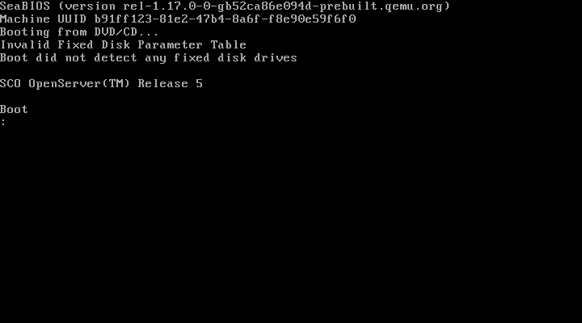

- `link=vscsi btld=fd(64)` loads the driver from the boot image itself
- `Sdsk=vscsi(0,0,1)` says the disk is at LUN 1
- `Srom=vscsi(0,0,0)` says the CD-ROM is at LUN 0
- `clock.disable_short_timers=1` is unrelated to the driver, but you want it.
  OpenServer programs the legacy timer for periods KVM clamps, so the guest
  clock drifts. If you are unsure whether your release has the tunable, look for
  it in `/etc/conf/pack.d/clock/space.c` on the installed system. 5.0.5 does not
  have it, so leave it off the boot string there.

Answer the `Please insert the fd(64)vscsi volume` prompt with Return. The volume
is the boot image you are already booting from.

Both devices should appear:

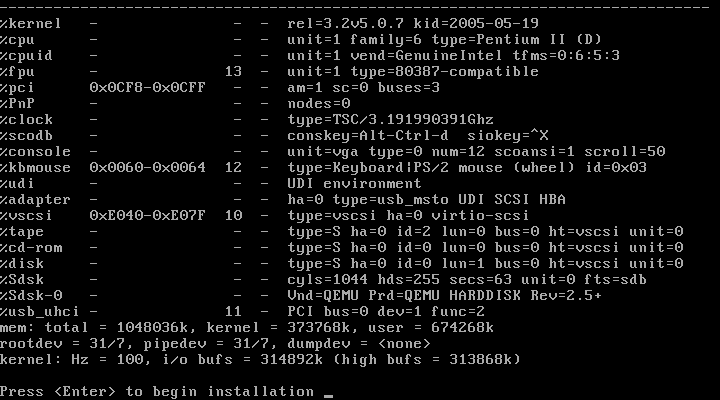

`hds=255 secs=63` is the check that matters. That geometry is what SeaBIOS
computes on its own, so nothing has to be forced and the disk attaches as an
ordinary managed Proxmox disk. Snapshots, backups and clones all work.

On 5.0.5 the installer asks for the driver disk as soon as you press Enter to
begin:

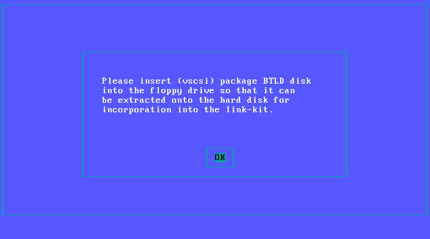

Press Enter. It carries on to the licence agreement.

---

## 3. Run the installer

> ### Thing to know #1: the media screen picks the wrong adapter
>
> "Identifying the installation media device" reports the right address, but
> defaults **SCSI Adapter Type** to `usb_msto, USB Host Adapter`. Press Space
> and choose `vscsi`. There are only two entries.
>
> 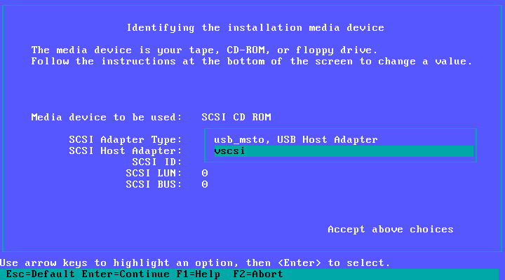
>
> 5.0.5 gets this right by itself. The screen comes up with `vscsi` already
> chosen: accept it.

> ### Thing to know #2: loading the BTLD into the link kit fails
>
> This is expected, and documented by SCO. You will see:
>
> 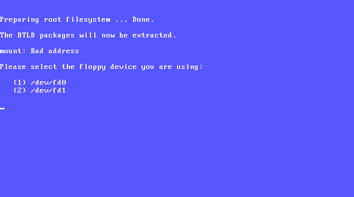
>
> Choose **(2)**, press Return at the "insert the floppy" prompt, and when it
> fails again choose **(b) abort BTLD load, but continue installation**.
>
> 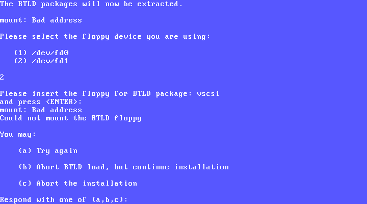
>
> The install completes normally. The driver goes into the installed kernel in
> the next step.
>
> On 5.0.5 this comes early, straight after `Preparing root filesystem` and
> before any files are copied. The answers are the same:
>
> 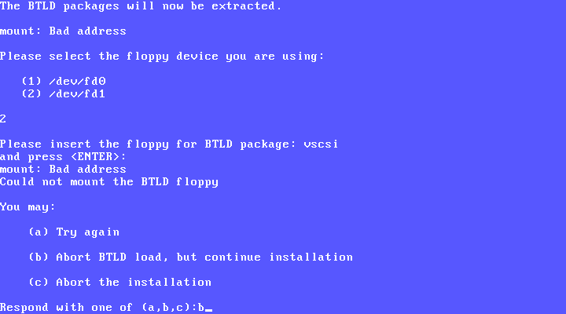

Everything else is a standard OpenServer install.

---

## 4. Put the driver into the installed kernel

The install is finished, but the on-disk kernel has no driver yet, so it cannot
boot on its own. Boot from the CD once more, onto the installed root.

At the `Boot :` prompt:

```
defbootstr link=fd(64)vscsi root=hd(42) Sdsk=vscsi(0,0,1) Srom=vscsi(0,0,0) clock.disable_short_timers=1
```

> ### Thing to know #3: do this from single-user mode
>
> If you press Ctrl-D past single user, you are running the install kernel
> against the installed system's `inittab`, which expects twelve console screens
> the install kernel does not provide. Each one fails and retries, and your
> console fills with:
>
> ```
> INIT: Command is respawning too rapidly.
> ```
>
> It is harmless, but it lands on top of the commands you are about to type.
> Stay in single user.

Then:

```sh
mount /dev/cd0 /mnt
mkdir /mnt2
marry -a /mnt/osr507-virtio-btld.img
mount -r /dev/marry/mnt/osr507-virtio-btld.img /mnt2
btldinstall /mnt2                 # take the default: vscsi
/etc/conf/cf.d/link_unix -y
umount /mnt2
marry -d /dev/marry/mnt/osr507-virtio-btld.img
umount /mnt
haltsys
```

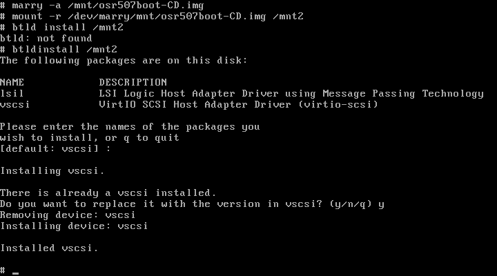

> **Do not skip `link_unix`.** `btldinstall` prints a success message and stops
> without touching `/stand/unix`, so it reads as finished when it is not. Skip
> it and the next boot panics with
> `PANIC: srmountfun - Error 19 mounting rootdev`, which looks like a much worse
> problem than it is.

On 5.0.6 there are two differences here:

1. The image is called `osr506-virtio-btld.img`.
2. `mount /dev/cd0 /mnt` fails with `No such device`. The installed system gives
   `Srom` major number 47, but the install kernel you are running uses 51. Use a
   throwaway device node instead. Leave `/dev/cd0` alone, it is correct once you
   are booted normally:

   ```sh
   mknod /tmp/c51 b 51 0
   mount -r /tmp/c51 /mnt
   ```

   Also, `link_unix -y` still asks two questions on 5.0.6, "boot by default?"
   and "kernel environment rebuilt?". Answer `y` to both.

On 5.0.5 there are four:

1. Leave `clock.disable_short_timers=1` off the boot string.
2. The image is called `osr505-virtio-btld.img`.
3. `mount /dev/cd0 /mnt` fails as it does on 5.0.6, and the same two `mknod`
   and `mount` lines get round it.
4. `btldinstall` says there is already a `vscsi` installed and asks whether to
   replace it. Answer `y`.

   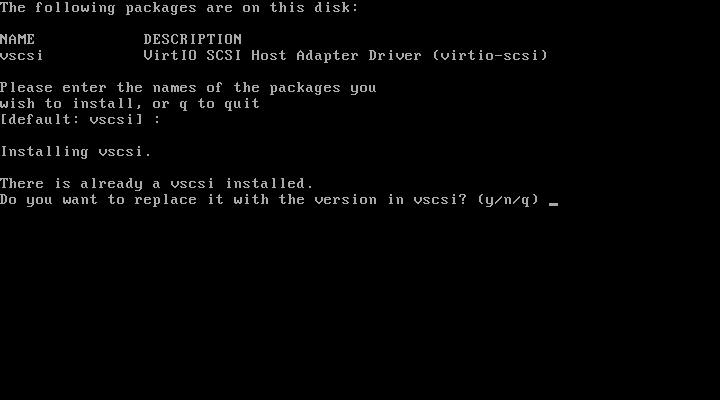

`link_unix -y` asks nothing at this point on 5.0.5.

---

## 5. Boot from the disk

```sh
qm set 507 --boot order=scsi1
```

That is the only change. Start it, with no boot string:

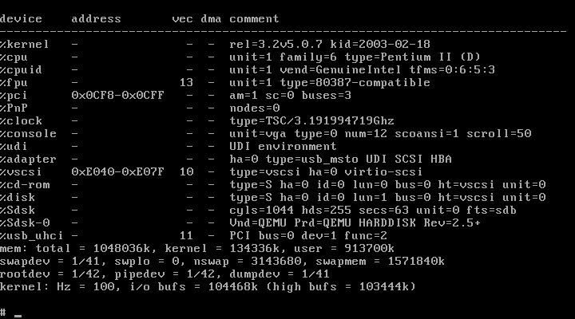

`rootdev = 1/42` is the ordinary value. OpenServer's device numbering follows
the disk's unit number rather than its SCSI LUN, so a root disk at LUN 1 changes
nothing.

It is worth confirming the installer wrote the right map. It does this
unprompted on both releases:

```sh
grep -v '^\*' /etc/conf/cf.d/mscsi
vscsi	Srom	0	0	0	0
vscsi	Sdsk	0	0	1	0
```

Then set up the network: [NETWORK.md](NETWORK.md).

---

## 5.0.5: if it says no user licences were found

A 5.0.5 system installed with today's date boots with this, and then spends a
minute or so failing to start its TCP services:

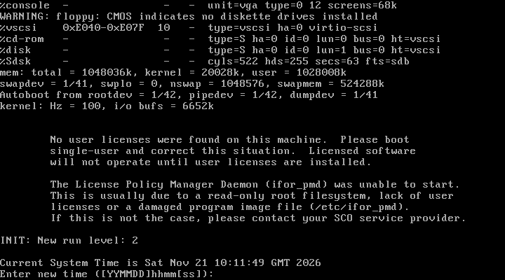

It is not the drivers. OpenServer 5.0.0 to 5.0.5 miscalculate when a licence
expires if it is installed with a date after 2000:
[SCO's article on it](https://scoexpert.com/kb/sco-openserver-license-is-showing-as-expired-even-though-it-s-ta126473/).
The fix is to enter the licence while the clock reads a date before 2000, and
Proxmox can set the clock for you. Shut the VM down, then:

```sh
qm set 505 --startdate 1999-11-21T10:00:00
```

Start it, enter the licence again in the License Manager (`scoadmin license`),
and shut it down. Then put the clock back and start it:

```sh
qm set 505 --delete startdate
```

The VM has to be stopped and started for the clock to change. A reboot from
inside the guest keeps the old one.

---

## What else is on the 5.0.5 disc

`osr505-virtio-install-1.0.1.iso` also carries the operating system updates a
5.0.5 system needs before it can run current software, and the software itself,
so none of it has to be fetched over a network:

| on the disc | what |
|---|---|
| `updates/1-rs505a` to `updates/5-oss646c` | RS505A, OSS497C, OSS640A, OSS642A and OSS646C, numbered in the order they go on |
| `updates/6-gwxlibs`, `updates/7-prngd` | the graphics, web and X11 libraries, and an entropy daemon, which OpenSSH needs |
| `software/` | curl with TLS, gzip, and OpenSSH 10.5p1 with its start-up scripts |
| `scoexpert.txt` | every command, in order, with the paths on the disc |

```sh
mount -r /dev/cd0 /mnt
more /mnt/scoexpert.txt
```

Each update installs with one command, for example
`custom -p SCO:SLS -i -z /mnt/updates/2-oss497c`. The two that relink the
kernel, RS505A and OSS497C, leave the virtio disk driver in it.

The same steps without the disc, and what each one is for, are in
[How to Install OpenSSH 10.5 on SCO OpenServer 5.0.5](https://scoexpert.com/guides/openssh-sco-openserver-5-0-5/).

---

## Upgrading an existing system

If OpenServer is already installed, on IDE, on an emulated LSI card, or
anywhere else, you do not need to reinstall.

```sh
mount -r -f HS,lower /dev/cd0 /mnt
pkgadd -d /mnt/drivers/vscsi-1.0.0.pkg all
```

Or download [`vscsi-1.0.0.pkg`](download/vscsi-1.0.0.pkg) directly.

The package stages the driver and registers it with the Link Kit, but does not
relink. This is the root disk driver, so you choose the moment:

```sh
/etc/conf/cf.d/link_unix -y
reboot
```

`link_unix` backs the running kernel up to `/stand/unix.old` first. If the new
one will not boot, type `hd(40)unix.old` at the Boot prompt to get back in.

If you are adding a virtio disk to a machine that boots from something else, add
its `mscsi` line, `vscsi Sdsk 0 0 N 0` for LUN N, then run `mkdev hd` to
partition it.

---

## Moving a 5.0.5 system from IDE to virtio

This is for a 5.0.5 system that already exists on emulated IDE. For a new
install, boot the CD as above.

These are the steps that moved a 5.0.5 system, installed on emulated IDE with
the emulated PCnet card, onto a virtio disk and network. They were tested on
5.0.5 only, with RS505A, OSS497C, OSS640A, OSS642A and OSS646 applied.

Take a snapshot first. Until step 4 the system still boots on IDE.

**1. Install the packages and relink.** Copy `vscsi-1.0.0.pkg` and
`vnet-1.0.1.pkg` to the system (FTP in binary mode will do), then:

```sh
pkgadd -d /tmp/vscsi-1.0.0.pkg all
pkgadd -d /tmp/vnet-1.0.1.pkg all
/etc/conf/cf.d/link_unix -y
```

On a 5.0.5 with those supplements applied, `link_unix -y` still asks two
questions: whether the kernel should boot by default, and whether to rebuild the
kernel environment. Answer `y` to both, or the new kernel is built but never
copied to `/stand/unix`.

The relink prints `idmknod: Cannot find device vnet in ... mdevice`. That is
harmless: the package registers its device node before the adapter has been
added, which happens in step 5.

**2. Switch on the SCSI disk driver.** An IDE install leaves `Sdsk` out of the
kernel. Enable it, add the disk to the SCSI table, and relink again:

```sh
cd /etc/conf/sdevice.d
cp Sdsk /tmp/Sdsk.orig
sed '/^Sdsk/s/N/Y/' /tmp/Sdsk.orig > Sdsk
echo "vscsi Sdsk 0 0 1 0" >> /etc/conf/cf.d/mscsi
/etc/conf/cf.d/link_unix -y
```

**3. Tell the kernel the root disk is SCSI.** In `/etc/default/boot`, add
`hd=Sdsk Sdsk=vscsi(0,0,1)` to the end of the `DEFBOOTSTR` line:

```
DEFBOOTSTR=hd(40)unix swap=hd(41) dump=hd(41) root=hd(42) hd=Sdsk Sdsk=vscsi(0,0,1)
```

After this a plain Enter at `Boot :` no longer boots the IDE disk. To bring the
system up on IDE again, type the original string at the prompt.

**4. Shut down and change the VM.** The disk goes on `scsi1` with an empty
CD-ROM on `scsi0`, as in a fresh install, and the network card becomes virtio:

```sh
qm set 505 --scsihw virtio-scsi-pci
qm set 505 --delete ide0
qm set 505 --scsi1 local-lvm:vm-505-disk-0,cache=writeback
qm set 505 --scsi0 none,media=cdrom
qm set 505 --net1 virtio,bridge=vmbr0
qm set 505 --delete net0
qm set 505 --boot order=scsi1
```

The emulated PCnet card has to go when the disk moves. QEMU puts it on the same
interrupt as the virtio-scsi controller, and the PCnet driver will not share it.

**5. Boot, then move the network.** In the Network Configuration Manager, remove
the PCnet adapter, relink and reboot. Then add the VirtIO adapter as described
in [NETWORK.md](NETWORK.md).

---

## Adding more disks

Extra disks go in higher slots and get correspondingly higher LUNs:

```sh
qm set 507 --scsi2 local-lvm:32
```
```
vscsi	Sdsk	0	0	2	0      <- in /etc/conf/cf.d/mscsi
```

Then `mkdev hd`, relink and reboot.

The driver handles up to four controllers, `ha=0` to `ha=3`, if you use
`--scsihw virtio-scsi-single`, which gives each disk its own. On a
multiprocessor guest stay with `virtio-scsi-pci` instead, because
`virtio-scsi-single` puts the controllers behind a PCI bridge that MPX cannot
route interrupts through.

---

## Troubleshooting

**`error loading hd(40)/boot` when booting from disk.** Geometry mismatch. The
disk was installed under a different translation to the one the BIOS reports.
This should not happen with these images, which report 255/63 to match SeaBIOS.
On an older install, `dparam(ADM)` can rewrite the master boot block.

**`PANIC: srmountfun - Error 19 mounting rootdev`.** The kernel loaded but has
no driver in it, which means `link_unix` was skipped after `btldinstall`. Boot
the CD again and run it.

**No `%vscsi` line at boot, then `hd: no root disk controller was found`.** The
relinked kernel was never copied to `/stand`, so the kernel that booted has no
driver in it. Boot on IDE, run `link_unix -y` again and answer `y` to both of
its questions.

**`Ignoring "hd=Sdsk" : Unknown driver`.** The `Sdsk` driver is not in the
kernel. An IDE install leaves it switched off: see step 2 of
[Moving a 5.0.5 system from IDE to virtio](#moving-a-505-system-from-ide-to-virtio).

**`Cannot install intr vecno=10, type=4, IPL=5`, then `Vector 10 is private`.**
The emulated PCnet card and the virtio-scsi controller are on the same
interrupt, and the PCnet driver claims it for itself. Remove the PCnet card from
the VM.

**`No user licenses were found on this machine` on 5.0.5.** The licence was
entered with a date after 2000. See
[5.0.5: if it says no user licences were found](#505-if-it-says-no-user-licences-were-found).

**`mount: cannot stat '/dev/cd0': No such device` when booted from the CD onto
the installed root.** Expected on 5.0.5 and 5.0.6. Use the `mknod` lines in
step 4.

**CD-ROM reads fail and it identifies as `QEMU HARDDISK`.** The CD is not on
`scsi0`. See [why the CD-ROM goes on scsi0](#why-the-cd-rom-goes-on-scsi0).

**The machine keeps booting the CD after installing.** Set
`qm set 507 --boot order=scsi1`.

**The guest clock drifts.** Add `clock.disable_short_timers=1` to `DEFBOOTSTR`
in `/etc/default/boot` so it applies to every boot, not just the one you typed
it on.
