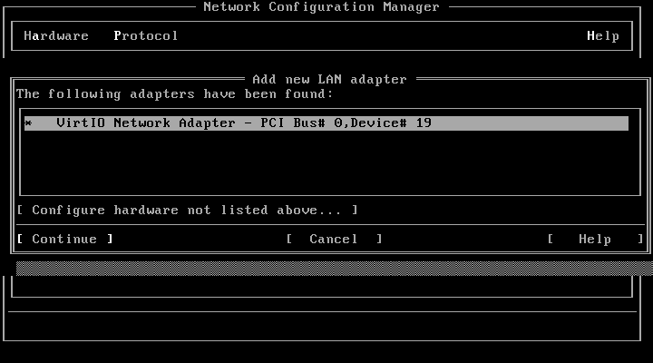

# Networking

`vnet` is an MDI network driver, so OpenServer's own TCP/IP stack drives a
virtio-net device. `scoadmin` finds it by PCI ID, configures it, and it behaves
like any other adapter afterwards.

## Why it is worth installing

Throughput is vastly improved over the emulated adapter OpenServer would
otherwise use. It is the difference between a machine you can copy files to and
one you avoid copying files to.

Measured with 200 MB of incompressible data over plain HTTP, three passes each,
no encryption in the way, and the source file resident in cache so the figures
reflect the network path rather than the disk:

| direction | throughput |
|---|---|
| host to guest | 123-131 MB/s, about 1 Gbit/s |
| guest to host | 50-53 MB/s, about 400 Mbit/s |

Receive is faster than transmit, which is normal for this kind of driver.

**Your numbers will differ.** These were taken on:

- Dell OptiPlex 7090, Intel Core i5-10505 at 3.20 GHz, 12 threads, 16 GB RAM
- Proxmox VE 9.2.2
- Guest: OpenServer 5.0.7, MPX kernel, 2 CPUs, 3 GB RAM

Both endpoints were on the same host, so traffic stayed on the software bridge
and never touched a wire. Across a real 1 GbE LAN to a separate machine the same
test gave 60-66 MB/s receiving and 40-42 MB/s transmitting, which is the
physical link doing the limiting rather than the driver.

There is no link speed to negotiate. virtio has no PHY and no wire, so the 1 Gb
the driver reports is advisory metadata for tools and routing decisions rather
than a limit. The real ceiling is host CPU and memory bandwidth.

## Set up the VM

Give the VM a virtio NIC. If you are installing OpenServer from scratch, add it
when you create the VM but defer network configuration during the install,
because the installer has no driver for it yet.

```sh
qm set 507 --net0 virtio,bridge=vmbr0
```

## Install the driver

The package is [`vnet-1.1.0.pkg`](download/vnet-1.1.0.pkg), 82 KB. For a
machine with no working network yet it is also on
[`vnet-nic.iso`](download/vnet-nic.iso); attach that as a CD-ROM and:

```sh
mount -r /dev/cd0 /mnt
pkgadd -d /mnt/vnet-1.1.0.pkg all
```

The one-disc installers carry an earlier version under `/drivers` (1.0.1, or
1.0.0 on the first discs). Those work, and can be upgraded afterwards as
described under [Upgrading an installed driver](#upgrading-an-installed-driver).

## Configure the adapter

```
scoadmin
```

Go to **Network Configuration Manager**, then **Hardware**, then **Add New LAN
Adapter**. It appears as "VirtIO Network Adapter", because SCO's own hardware
scan matches the PCI ID and names it without prompting:



Set the address in the same tool. Adding the adapter relinks the kernel itself,
which is the several-minute pause, then reboot when it asks.

That is all there is to it. `ifconfig -a` should show `net0` with your address,
and it is an ordinary SCO network interface from then on.

## LLC frames, and a bug in OpenServer's network stack

Version 1.0.1 of the driver drops one kind of received frame before it
reaches the stack: **LLC XID and TEST responses addressed to the null SAP**.
Nothing you use is carried in those; they are a station-management relic of
802.2. Everything else, including XID and TEST *commands* (which OpenServer
answers), is delivered exactly as before.

The reason is a defect in OpenServer's own LLC layer, which leaks a STREAMS
message block for every one of those responses it receives and never frees
it. That would be harmless if nothing sent them, but Sonos players broadcast
an XID response every few seconds, and some printers and switches do too.
On such a LAN the kernel's pool of small STREAMS blocks is starved within a
few hours: received frames start being dropped, ssh sessions fail under load,
and eventually `sshd` trips a null-pointer dereference in `getpeername()`
and the machine panics with

```
PANIC: k_trap - Kernel mode trap type 0x0000000E    cr2 0x0000000C
```

On a machine with the stock STREAMS limit (`NSTRPAGES` 500, i.e. 2 MB) the
end looks different: no panic, but the console fills with

```
WARNING: table_grow - mblock table page limit of 500 pages (NSTRPAGES) exceeded by 1 pages
WARNING: allocb - Cannot grow STREAMS message header table
```

repeating, and the network is simply gone — the VM keeps running, the guest
agent stops answering, and nothing but a reset brings it back. A migrated
production guest running 1.0.0 did exactly this after 17 days.

That happens with SCO's own drivers on real hardware as well — it is not a
virtio matter — but this driver is the one place we can fix it. If you see
that panic on a machine running 1.0.0, upgrade. To check whether your LAN
triggers the leak, watch `netstat -m` on an idle machine: the `mblks`
"alloc" column must not climb.

The filter can be turned off, and its count read, through two kernel
variables: `vnet_llc_filter` (1 = on) and `vnet_llc_dropped`, for example
`echo "od -d vnet_llc_dropped" | crash`.

## Version 1.1.0: fewer interrupts, and no burst at boot

Under a hypervisor the expensive things a driver does are port writes and
interrupts, because each is one or more exits from the guest to the host.
1.1.0 changes three things. The figures are from a two-CPU OpenServer 5.0.7
guest on Proxmox, the old and new behaviour measured on the same boot.

* **Transmit completions are no longer interrupts.** The driver takes its
  buffers back at the next transmit instead, and masks the receive interrupt
  while it is already draining the ring. For the same throughput that is
  65-90% fewer interrupts and 36-48% fewer exits, and the host spends a
  quarter to a half less CPU on the guest during a transfer.
* **Notifies are skipped when the host says it does not need one.** Every
  receive-side notify goes. Transmit notifies mostly remain.
* **Receive starts at boot rather than when the stack attaches.** With no
  receive buffers posted the host does not drop frames, it queues them, so
  everything sent to the guest during boot used to arrive in a single burst
  at the moment IP was being attached to the interface. Eleven boots in
  twenty lost frames in that burst, visible as input errors in `netstat -in`
  straight after boot. Frames that arrive before the stack attaches are now
  discarded as they come, and twelve boots in twelve lost none.

How much it helps depends on the far end. On a single-CPU 5.0.5 guest, and on
a 5.0.7 guest running nested on a cloud host, uploads were 16-17% faster and
downloads unchanged.

It has been run on 5.0.7 with the two-CPU kernel and on 5.0.5 with the
single-CPU kernel. It has not yet been run on 5.0.6.

The behaviour can be inspected, and switched back, through kernel variables.
Read them with `crash`, for example `echo "od -d vnet_intrs" | /etc/crash`:

```
vnet_intr_always            1 = interrupts as in 1.0.1 (default 0)
vnet_virtio_notify_always   1 = notify after every request (default 0)
vnet_intrs                  handler runs that found work flagged
vnet_intrs_empty            ... of which found nothing to do
vnet_tx_reclaimed           transmit buffers freed from the transmit path
vnet_tx_waits               times a backed-up queue turned the TX interrupt on
vnet_virtio_kicks           notifies written
vnet_virtio_kicks_skipped   notifies the host waived
```

## Upgrading an installed driver

```sh
pkgrm vnet
pkgadd -d ./vnet-1.1.0.pkg all
/etc/conf/cf.d/link_unix -y
reboot
```

`pkgadd` notices that an adapter is already configured, replaces its driver,
keeps the old one as `/etc/conf/pack.d/vnet/Driver.o.prev`, and tells you to
relink. Your address and the rest of the network configuration are untouched.

**Packages before 1.1.0 did not do this.** They only placed the driver where
the Network Configuration Manager finds it when an adapter is *added*; a
machine whose adapter was already configured went on running the copy the
kernel had been built from. So if you moved from 1.0.0 to 1.0.1 by removing
and re-adding the package, as this page used to describe, the running driver
did not change, and the Sonos fix described above is not in your kernel.

To check, compare the two copies:

```sh
sum -r /opt/vnet/Driver.o /etc/conf/pack.d/vnet/Driver.o
```

If the sums differ, the kernel is not running the installed package. Install
1.1.0 as above and it will be.
